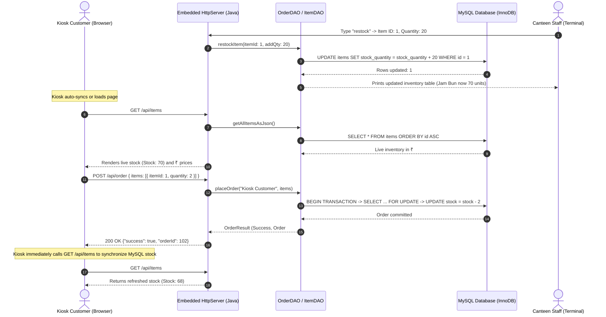

# Canteen Digital Ordering System - Touch-Screen Kiosk

A high-concurrency, ACID-compliant **Canteen Digital Ordering System & Touch-Screen Kiosk** built with **Java (JDBC)**, an **Embedded Java Web Server (`com.sun.net.httpserver.HttpServer`)**, and **MySQL/InnoDB**.

All prices, transactions, console tables, and front-end displays operate in **Indian Rupees (₹)**.

---

## 🌟 Key Features

1. **Interactive Admin Console with Manual Restocking (`Main.java`):**
   - Type `restock` in the server terminal to initiate manual stock replenishment.
   - Interactive prompt asks:
     1. `Enter Item ID to restock: `
     2. `Enter quantity to add: `
   - Executes MySQL query: `UPDATE items SET stock_quantity = stock_quantity + ? WHERE id = ?`.
   - Displays the refreshed live inventory table immediately after updating.

2. **Currency in Indian Rupees (₹):**
   - All dollar signs (`$`) have been converted to Indian Rupees (`₹`) across SQL schema seeds, Java console output, order receipts, and the front-end kiosk interface.

3. **Front-End Live Stock Refresh & Auto-Sync (`index.html`):**
   - **Page Load:** Dynamically fetches live stock levels from `GET /api/items`.
   - **Immediately After Order Placement:** Upon receiving order confirmation or rejection from `POST /api/order`, the kiosk immediately queries `GET /api/items` to refresh badge counts and card states from MySQL.
   - **Real-Time Periodic Sync:** Kiosk automatically polls `GET /api/items` every 4 seconds in the background so that any manual admin restock in the terminal is instantly visible to customers.

4. **Touch-Screen Kiosk Experience:**
   - **Screen 1 (Splash Screen):** "Touch Screen to Start Order" with ambient glow. Tapping transitions to ordering.
   - **Screen 2 (Ordering Page):**
     - Top category navigation bar (**All**, **Lunch**, **Drinks**, **Snacks**, **Biscuits**).
     - Square food item cards: Top-right live stock badge, center photo & item name, bottom-right price in ₹, bottom-left `+ Add` button / quantity stepper.
     - Bottom floating cart bar with live total in ₹ and **"Place Order"** button.
   - **Order Confirmation & 5-Second Auto-Reset:**
     - Displays order receipt modal with Order # and total paid in ₹.
     - 5-second countdown timer automatically resets the kiosk back to the Splash Screen for the next customer.

---

## 🏗️ Architecture & Interaction Flow



---

## 📁 File Structure

```
java_dbms/
├── .gitignore               # Ignores compiled class files and temporary logs
├── db.properties            # MySQL database credentials
├── DatabaseConnection.java  # JDBC connection manager
├── Item.java                # Menu Item model with category, ₹ price, stock & JSON
├── ItemDAO.java             # Menu reads, category filtering, restocking & live inventory
├── OrderDAO.java            # ACID transaction engine with row-level locking
├── KioskServer.java         # Embedded HttpServer serving REST API and index.html
├── Main.java                # Launcher with interactive manual restocking console
├── index.html               # Touch-Screen Kiosk Front-End (₹ currency, live auto-sync)
├── schema.sql               # Database DDL, sample menu in ₹, constraints & indexes
├── lib/
│   └── mysql-connector-j-8.4.0.jar  # MySQL JDBC Driver
└── README.md                # Documentation & run instructions
```

---

## 🚀 Setup & Running Instructions

### Step 1: Initialize Database & Schema
Open PowerShell or your terminal and execute `schema.sql`:

```bash
mysql -u root -p < schema.sql
```

### Step 2: Configure Database Credentials
Edit `db.properties` with your local MySQL password:

```properties
db.url=jdbc:mysql://localhost:3306/canteen_db?useSSL=false&allowPublicKeyRetrieval=true&serverTimezone=UTC
db.user=root
db.password=your_mysql_password
```

### Step 3: Compile the Project
**On Windows (PowerShell / CMD):**
```powershell
javac -cp ".;lib/*" *.java
```

**On Linux / macOS (Bash):**
```bash
javac -cp ".:lib/*" *.java
```

### Step 4: Run the Server
**On Windows (PowerShell / CMD):**
```powershell
java -cp ".;lib/*" Main
```

**On Linux / macOS (Bash):**
```bash
java -cp ".:lib/*" Main
```

- Browser will automatically open to 👉 **`http://localhost:8080`**.
- In the terminal console, type:
  - `restock`: prompts for Item ID and quantity to manually replenish stock.
  - `status`: prints the real-time inventory table with ₹ pricing.
  - `exit`: gracefully stops the server.
